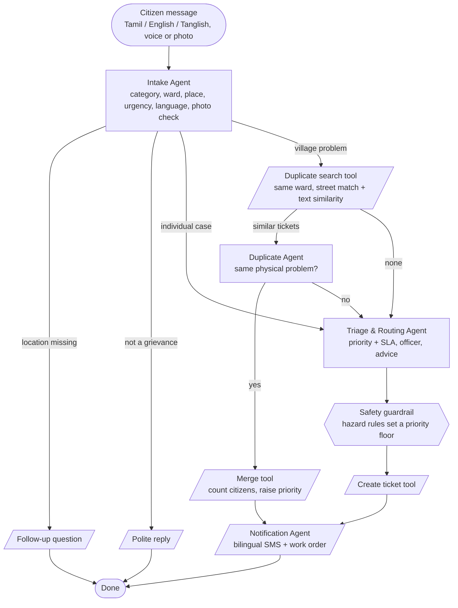

# AI Panchayat — agent architecture

## The complaint graph

Every citizen message runs through a state graph (`panchayat/graph.py`). Nodes are **agents** (they reason, using Gemini with an offline fallback) or **tools** (deterministic actions on the database). After each node a **router** reads the shared state and picks the next node.

Two more agents run outside the complaint flow:

| Agent | Trigger | What it does |
|---|---|---|
| Escalation Agent | "Run escalation check" (or a scheduler) | Finds overdue tickets, escalates one level at a time (Panchayat Secretary → President → BDO, 24 h each), reminds officers at 75% of their SLA, writes escalation notes with Gemini, informs citizens. |
| Development Insights Agent | "Write Gram Sabha brief" | Aggregates complaints by ward × category and hotspot streets, then writes a brief with priority works, possible funding sources, Gram Sabha agenda and risks. |

## Agents in detail

| Agent | Input | Decision | Output schema (Gemini structured JSON) | Offline fallback |
|---|---|---|---|---|
| Intake | complaint text, optional photo and ward | Is it a grievance? Which category? Where? How urgent? Ask a follow-up? | `is_grievance, category, title, summary_en, summary_ta, language, ward, location, needs_followup, followup_en/ta, urgency_signals[], emergency, photo_observation, reply_en/ta` | Keyword tables in English, Tamil and Tanglish; street directory → ward |
| Duplicate | new complaint + up to 3 similar open tickets | Same physical problem? | `is_duplicate, ticket_id, confidence, reason` | Same street + same category, or text similarity ≥ 0.55 |
| Triage & Routing | structured complaint + routing table | Priority under the SLA policy, officer steps, citizen advice | `priority, reason, officer_instructions, citizen_advice_en, citizen_advice_ta` | Hazard / disruption / request rules |
| Escalation | overdue tickets | Escalation note and action per ticket | `notes[{ticket_id, note, action}]` | Template note |
| Insights | complaint statistics | Priority works, funding, agenda, risks | `headline, priority_works[], gram_sabha_agenda[], risks[]` | Ranks ward × category by citizen reports |

## SLA policy

| Priority | Meaning | Act within |
|---|---|---|
| P1 Critical | Danger to life or public health (live wire, sewage in drinking water, open manhole) | 24 hours |
| P2 High | Essential service disrupted, vulnerable people affected | 3 days |
| P3 Medium | Service degraded, no immediate risk | 7 days |
| P4 Low | Requests, suggestions, routine paperwork | 15 days |

A merged duplicate can raise priority: one level when 3 and 6 citizens have reported it, and straight to P1 if the new report shows a hazard.

## Reliability design

- **Guardrail**: deterministic hazard rules set a minimum priority. If Gemini returns a lower priority for a live wire, the guardrail raises it and logs that it did.
- **Graceful degradation**: each agent catches Gemini errors (rate limit, bad JSON, network, invalid key) and falls back to the offline engine for that step only. The trace records the fallback reason.
- **Model auto-selection**: the client lists the models the API key can use and prefers the newest Flash-Lite, then Flash. Models that return 404 or have no free quota are skipped automatically.
- **Request-format fallback**: tries the current structured-output field (`responseFormat`), then `responseJsonSchema`, then plain JSON mode, remembering what worked.
- **Rate limits**: honours retry delays once, then cools down for 60 s so citizens never wait on a stuck call. Per-IP limits protect the public demo's quota.
- **Audit trail**: every agent decision is stored as an event on the ticket; every message sent is stored as a notification.

## Data model (SQLite)

`tickets` (one per physical problem) · `reports` (one per citizen message, linked to a ticket) · `events` (agent and officer actions) · `notifications` (simulated SMS / WhatsApp) · `settings` (demo clock).
