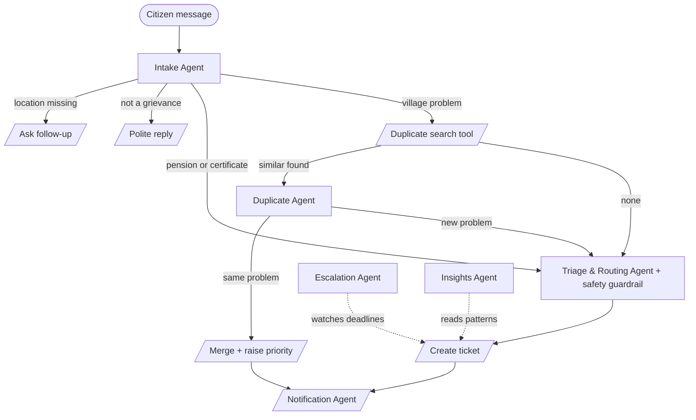

# AI Panchayat — agentic grievance redressal for village panchayats

**Track:** Social Impact & Sustainability AI · **Live demo:** `https://YOUR-APP.onrender.com` · **Built with:** Google Gemini API, Python, Flask

Villagers report problems the way they talk: in Tamil, English or Tanglish, often without a ward number, often about something ten neighbours already reported. Panchayat staff then retype, sort and chase every complaint by hand, and the urgent ones (a fallen live wire, sewage in drinking water) wait in the same pile as a speed-breaker request.

AI Panchayat puts a team of agents between the citizen and the panchayat office:

| Agent | What it does on its own |
|---|---|
| 🧾 **Intake Agent** | Understands Tamil, English and Tanglish text, voice and photos. Extracts the problem, street, ward and urgency. Asks one follow-up question if the location is missing. |
| 🧠 **Duplicate Agent** | Searches open tickets in the same ward and decides if this is the same physical problem. Merges repeat reports and counts how many citizens are affected. |
| ⚖️ **Triage & Routing Agent** | Sets priority under the panchayat SLA (24 h / 3 days / 7 days / 15 days), assigns the right officer, writes their work steps and a safety tip for the citizen. A **safety guardrail** stops the AI from under-rating hazards. |
| 📣 **Notification Agent** | Sends a bilingual SMS to the citizen and a work order to the officer (simulated). |
| ⏰ **Escalation Agent** | Watches every deadline. Reminds officers, then escalates late complaints up the chain: Panchayat Secretary → President → Block Development Officer. |
| 📊 **Development Insights Agent** | Turns complaint patterns into a Gram Sabha brief: which permanent works to approve, where, and possible funding sources. |

## Try it

Open the live demo and click an example on the **Report a problem** tab:

- **⚡ Fallen live wire** → P1 Critical in under 24 h, routed to the Electricity Board, emergency advice in Tamil and English.
- **🔁 Repeat drainage report** → merged into the existing ticket instead of creating a new one; the citizen count goes up.
- **❓ Vague complaint** → the agent asks *where*, then completes the ticket from your answer.
- **💡 Street light, in Tamil** → the ward is found from the street name.

Then open **Officer desk** (resolve a ticket and every reporting citizen is notified), **Escalations** (move the demo clock forward and run the check), **Development insights** (write the Gram Sabha brief) and **Test lab** (run all 11 scenarios against the live agents).

## Architecture



- `panchayat/graph.py` — a small state-graph orchestrator: nodes, routers, shared state, streamed trace.
- `panchayat/agents.py` — the complaint agents and tools.
- `panchayat/llm.py` — Gemini REST client: structured JSON output, model auto-selection, format fallback, rate-limit cool-down.
- `panchayat/offline.py` — offline engine for Tamil/English/Tanglish: fallback brain and safety guardrail.
- `panchayat/escalation.py`, `panchayat/insights.py` — the two background agents.
- Full details: [docs/ARCHITECTURE.md](docs/ARCHITECTURE.md).

Every decision is visible: the UI streams each agent's step live, and every ticket keeps an audit trail of which agent did what and why.

## Tests

```bash
python -m unittest discover -s tests -t .    # 37 tests, no API key or internet needed
python -m tests.report                       # writes docs/TEST_REPORT.md
GEMINI_API_KEY=... python -m tests.report --live   # same scenarios against real Gemini
```

The 11 end-to-end scenarios (English, Tamil, Tanglish, emergency, duplicate merge, follow-up, off-topic, health risk, individual case, escalation) also run from the app's **Test lab** tab. Results: [docs/TEST_REPORT.md](docs/TEST_REPORT.md).

## Run locally

```bash
pip install -r requirements.txt
cp .env.example .env          # put your free Gemini key in GEMINI_API_KEY
python app.py                 # http://localhost:7860
```

Without a key the app still works on the offline engine and says so in the header.

## Deploy free on Render

1. Get a free Gemini API key at [aistudio.google.com](https://aistudio.google.com) → **Get API key**.
2. Push this folder to a GitHub repository.
3. On [render.com](https://render.com): **New → Blueprint**, pick the repository (it reads `render.yaml`), paste the key when asked for `GEMINI_API_KEY`, and deploy.
4. Open the `onrender.com` URL. The header should say **Gemini connected**.

Free Render services sleep after 15 minutes without traffic and take about a minute to wake. A `Dockerfile` is included for other hosts.

## API

| Method | Path | Purpose |
|---|---|---|
| POST | `/api/complaints/stream` | Run the agents; streams each step as NDJSON, then the result |
| POST | `/api/complaints` | Same, as one JSON response |
| GET | `/api/tickets`, `/api/tickets/<id>` | Ticket list (filters: ward, category, status, priority, q) and detail |
| POST | `/api/tickets/<id>/status` | Officer update (IN_PROGRESS, RESOLVED, OPEN) with citizen notification |
| POST | `/api/escalation/sweep` | Run the Escalation Agent |
| POST | `/api/insights/brief` | Run the Insights Agent |
| POST | `/api/scenarios/run` | Run the test scenarios (NDJSON stream) |
| GET | `/api/status`, `/api/graph` | Engine status and the agent graph |

## Limits and next steps

- SMS and WhatsApp are simulated; the next step is a WhatsApp Business / SMS gateway and an IVR line for feature phones.
- The ward directory and officers are sample data; a real panchayat would load its own.
- SQLite is fine for a demo; a deployment would use PostgreSQL and a scheduler for the Escalation Agent.
- Planned: photo proof of completion from officers, citizen satisfaction rating, Tamil voice replies.

All names, streets and complaints in the demo are fictional.

---
Built for the Ziro Digital Agentic AI Hackathon 2026 · MIT License
